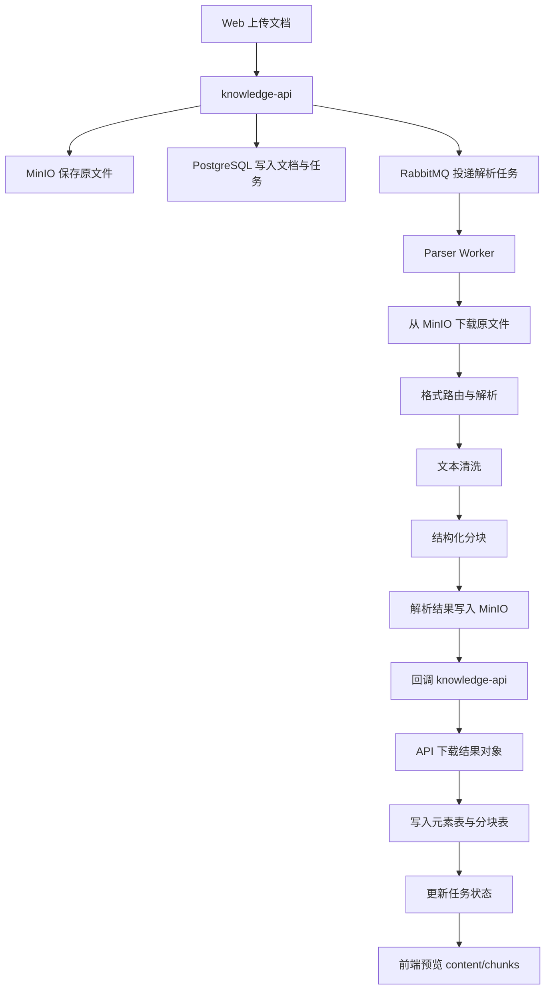
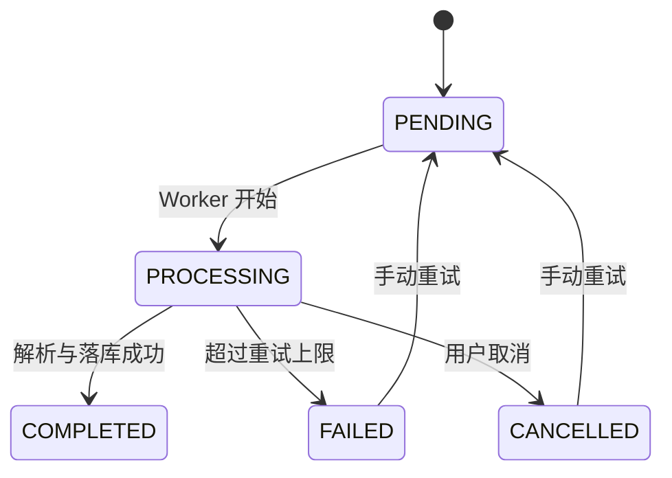

# 文档解析模块开发设计

- 版本：v1.0（待评审）
- 日期：2026-11-19
- 范围：开发设计说明，不包含编码实现
- 对应架构文档：`Agent Knowledge Base Platform.md` 第 4、5、11、14 章

## 1. 背景与现状

当前工程已完成第一阶段基础能力：登录、知识库 CRUD、文档上传、权限隔离、逻辑删除、Docker Compose 部署均已可运行。Parser Worker 也已具备“解析 → 清洗 → 分块 → 可选 Embedding → 回调”的代码骨架。

但解析链路尚未形成闭环，主要缺口如下：

1. Worker 回调只更新 `kb_parse_task` 的状态、进度和错误信息，`result` 中的解析结果没有写入业务表。
2. `GET /api/v1/documents/{id}/content` 与 `GET /api/v1/documents/{id}/chunks` 仍返回 501。
3. `kb_document_element`、`kb_chunk` 表已存在，但没有稳定的写入方和版本归属字段，重新解析时无法区分新旧结果。
4. 任务失败重试依赖消息 requeue，缺少死信队列、幂等键和统一错误码。
5. 12 种目标格式中，部分 Parser 仍是骨架或依赖外部引擎，没有逐格式验收用例。

本设计的目标是补齐上述缺口，让“上传文档 → 异步解析 → 结果落库 → 前端预览 → 失败重试”形成可验证的完整链路。

## 2. 目标与非目标

### 2.1 目标

- 12 种目标格式均能完成解析并输出统一文档结构。
- 解析结果（元素、分块）持久化到 PostgreSQL，并支持按文档版本追溯。
- 前端能够在线查看解析原文、结构化元素和分块结果。
- 任务具备幂等、重试、超时、取消、失败原因记录能力。
- 重新解析时旧结果逻辑删除，新结果可追溯。
- 与第三阶段 RAG 核心解耦：本阶段只负责产出干净、可索引的分块，不负责写入 ES/Qdrant。

### 2.2 非目标

- 不实现 Elasticsearch / Qdrant 索引写入，属于第三阶段。
- 不实现 RAG 问答与混合检索，属于第三、四阶段。
- 不训练或微调 OCR / Embedding 模型。
- 不实现商业化、计费、多租户计费。
- 本次不编码，只输出设计方案与验收标准。

## 3. 总体架构



### 3.1 职责边界

| 组件 | 职责 | 不负责 |
| --- | --- | --- |
| knowledge-api | 接收上传、建任务、投递消息、接收回调、落库解析结果、提供预览接口 | 不执行具体格式解析 |
| RabbitMQ | 任务队列、重试、死信 | 不保存解析内容 |
| Parser Worker | 下载文件、格式解析、清洗、分块、上传解析结果、回调状态 | 不直接写 PostgreSQL |
| MinIO | 保存原文件与解析结果 JSON | 不解析业务语义 |
| PostgreSQL | 保存文档元数据、任务状态、元素、分块 | 不保存大体积原始二进制 |

这样设计的原因：Worker 不直连数据库，符合“REST API 是唯一业务入口”的项目约定；大体积解析结果通过 MinIO 传递，避免回调请求体过大。

## 4. 关键流程设计

### 4.1 上传与任务创建

1. 前端调用 `POST /api/v1/documents/upload`，携带 `knowledge_base_id` 与文件。
2. API 校验：
   - 用户具备该知识库 `WRITE` 权限；
   - 文件类型在白名单内；
   - 文件大小不超过配置上限；
   - 通过文件头（magic number）二次校验真实类型，避免仅信任扩展名。
3. API 将原文件上传至 MinIO，对象键格式：`documents/{document_id}/{uuid}{ext}`。
4. API 写入 `kb_document`，状态 `PENDING`。
5. API 创建 `kb_parse_task`，状态 `PENDING`，`retry_count=0`。
6. API 向 `kb.parse.exchange` 投递消息，routing key 为 `kb.parse.created`。

### 4.2 Worker 解析

1. Worker 消费 `kb.parse.queue`，手动 ack，`prefetch_count=1`。
2. 从任务消息读取 `storage_key`，通过 MinIO SDK 下载到临时目录。
3. 根据 `file_type` 路由到对应 Parser。
4. Parser 输出统一文档结构（`Document` → `Element[]`）。
5. `TextCleaner` 执行清洗：去空行、规范化空白、合并碎片、过滤页眉页脚噪声。
6. `StructuredChunker` 按文件类型与知识库分块配置生成 `Chunk[]`。
7. 将完整解析结果序列化为 JSON，上传至 MinIO：`parse-results/{task_id}/{attempt}.json`。
8. 回调 API：`POST /api/v1/tasks/{id}/callback`，payload 只携带状态、进度、结果对象键和统计信息。

### 4.3 结果落库

1. API 校验回调令牌（`Authorization: Bearer <internal_token>`）。
2. 根据 `task_id` 查询任务，校验任务存在且处于可回调状态。
3. 若 `status=COMPLETED`：
   - 从 MinIO 下载 `result_key` 对应 JSON；
   - 校验 `schema_version` 与 `document_id`；
   - 将旧版本 `kb_document_element`、`kb_chunk` 逻辑删除；
   - 批量写入新元素与分块；
   - 更新任务状态为 `COMPLETED`，写入统计摘要。
4. 若 `status=FAILED`：
   - 更新任务状态、失败原因、结束时间；
   - 不清理旧版本结果，便于对比。
5. 回调接口返回 200 后，Worker 才 ack 消息。

### 4.4 前端预览

- `GET /documents/{id}/content`：返回文档元素列表和拼接后的纯文本。
- `GET /documents/{id}/chunks`：返回分块列表，支持按 `chunk_type`、`page` 过滤和分页。
- 前端解析结果弹窗展示：
  - 原文/元素视图；
  - 表格结构化视图；
  - 分块卡片，显示 `chunk_index`、字符数、标题路径、页码。

## 5. 统一数据结构

所有 Parser 输出必须遵循统一结构，后续清洗、分块、落库只依赖该结构。

```json
{
  "schema_version": "1.0",
  "task_id": 123,
  "document_id": 456,
  "file_name": "技术方案.docx",
  "file_type": "DOCX",
  "parser_version": "docx-parser-1.0",
  "elements": [
    {
      "element_id": "e_001",
      "type": "heading",
      "content": "系统架构",
      "level": 1,
      "page": 1,
      "page_start": 1,
      "page_end": 1,
      "heading_path": ["系统架构"],
      "source_file_id": null,
      "bounding_box": null,
      "table_data": null,
      "metadata": {}
    }
  ],
  "chunks": [
    {
      "chunk_id": "c_001",
      "parent_chunk_id": null,
      "element_ids": ["e_001", "e_002"],
      "chunk_index": 0,
      "chunk_type": "child",
      "content": "系统架构...",
      "token_count": 420,
      "heading_path": ["系统架构"],
      "page_start": 1,
      "page_end": 1,
      "metadata": {}
    }
  ],
  "stats": {
    "element_count": 1,
    "chunk_count": 1,
    "elapsed_ms": 860,
    "warnings": []
  }
}
```

字段约束：

- `element_id` 在单次解析任务内唯一。
- `chunk_id` 在单次解析任务内唯一。
- `element_ids` 表示分块来源元素，顺序与原文一致。
- `heading_path` 用数组保存，便于展示与检索过滤。
- `page_start/page_end` 用于来源定位；无分页概念的文件（如 TXT）统一为 1。
- `metadata` 存放格式特有字段，不参与检索排序。

## 6. 各格式解析策略

| 格式 | 首选方案 | 降级方案 | 关键保留信息 |
| --- | --- | --- | --- |
| DOCX | Docling | python-docx | 标题层级、段落、表格、页码 |
| DOC | LibreOffice 转 DOCX 后走 DOCX | 无 | 同上 |
| PPTX | python-pptx / Docling | LibreOffice 转 PDF 后 OCR | 幻灯片编号、文本框、表格、图片 |
| PPT | LibreOffice 转 PPTX | LibreOffice 转 PDF 后 OCR | 同上 |
| PDF | pdfplumber / Docling | OCR（PaddleOCR/Tesseract） | 页码、多栏顺序、表格、图片 |
| XLSX | openpyxl 流式读取 | LibreOffice 转 CSV | Sheet 名、行列坐标、表头、合并单元格 |
| XLS | LibreOffice 转 XLSX | 无 | 同上 |
| CSV | 编码探测 + csv 模块 | 按逗号兜底 | 表头、行列结构、分隔符 |
| MD | Markdown 标题解析 | 纯文本 | 标题层级、代码块、列表 |
| TXT | 段落切分 | 无 | 段落顺序 |
| PNG/JPG | OCR + 版面识别 | Tesseract | 文本、坐标、图片描述 |

解析策略原则：

1. 优先使用结构化解析，OCR 只作为扫描件或图片格式的兜底。
2. 表格必须输出 `table_data`，不能只塞进纯文本。
3. 解析失败时给出明确错误码，禁止静默返回空文档。
4. 新增格式只增加 Parser 实现，不修改 Worker 主流程。

## 7. 分块设计

### 7.1 分块策略

| 文件类型 | 分块单位 |
| --- | --- |
| DOCX/DOC | 标题、段落、表格 |
| PPTX/PPT | 幻灯片 |
| PDF | 标题、段落、页面 |
| MD | Markdown 标题 |
| TXT | 段落 |
| XLSX/XLS | Sheet、表格、行组 |
| CSV | 表头、行组 |
| PNG/JPG | OCR 文本块与图片描述 |

### 7.2 默认参数

| 参数 | 默认值 | 说明 |
| --- | --- | --- |
| `chunk_size` | 800 Token | 子块目标长度 |
| `chunk_overlap` | 100 Token | 相邻子块重叠 |
| `min_chunk_size` | 100 Token | 小于该值尝试与相邻块合并 |
| `max_chunk_size` | 1200 Token | 超过该值强制切分 |
| `parent_child_enabled` | true | 是否生成父块 |
| `parent_chunk_size` | 2400 Token | 父块目标长度 |

参数来源优先级：任务消息显式配置 > 知识库配置 > 系统默认值。

### 7.3 父子块规则

- 父块由同一标题路径下的连续子块聚合而成，用于检索命中后扩展上下文。
- 子块写入 `kb_chunk`，`chunk_type=child`。
- 父块写入 `kb_chunk`，`chunk_type=parent`，`parent_chunk_id=NULL`。
- 子块的 `parent_chunk_id` 指向父块 `chunk_id`。
- 第三阶段检索时默认召回子块，返回时可扩展父块。

## 8. 接口设计

### 8.1 解析任务消息（扩展）

现有字段保持不变，新增：

```json
{
  "task_id": 123,
  "document_id": 456,
  "knowledge_base_id": 1,
  "storage_key": "documents/456/uuid.docx",
  "file_name": "方案.docx",
  "file_type": "DOCX",
  "attempt": 1,
  "chunk_config": {
    "chunk_size": 800,
    "chunk_overlap": 100,
    "parent_child_enabled": true
  },
  "parser_version": "auto"
}
```

禁止在消息中携带任何令牌或密钥。

### 8.2 任务回调（扩展）

```json
{
  "task_id": 123,
  "status": "COMPLETED",
  "progress": 100,
  "message": "解析完成",
  "result_key": "parse-results/123/1.json",
  "result_summary": {
    "element_count": 42,
    "chunk_count": 18,
    "elapsed_ms": 860,
    "warnings": []
  },
  "timestamp": 1763529600
}
```

状态枚举：`PROCESSING` / `COMPLETED` / `FAILED` / `CANCELLED`。

### 8.3 预览接口

`GET /api/v1/documents/{id}/content` 响应：

```json
{
  "document_id": 456,
  "status": "COMPLETED",
  "content": "拼接后的纯文本",
  "elements": []
}
```

`GET /api/v1/documents/{id}/chunks` 响应：

```json
{
  "document_id": 456,
  "total": 18,
  "records": []
}
```

查询参数：`chunk_type`、`page`、`current`、`size`。

## 9. 数据库设计调整

现有 `kb_document_element`、`kb_chunk` 已具备核心字段，建议新增最小迁移，不重构既有表。

### 9.1 `kb_document_element` 新增字段

| 字段 | 类型 | 说明 |
| --- | --- | --- |
| `version_id` | BIGINT | 对应 `kb_document.version`，区分重新解析结果 |
| `parse_task_id` | BIGINT | 产生该元素的任务 ID |

建议索引：`(document_id, version_id, deleted)`。

### 9.2 `kb_chunk` 新增字段

| 字段 | 类型 | 说明 |
| --- | --- | --- |
| `parse_task_id` | BIGINT | 产生该分块的任务 ID |
| `element_ids` | JSONB | 分块来源元素 ID 列表 |

建议索引：`(kb_id, version_id, deleted)`、`(document_id, chunk_index)`。

### 9.3 `kb_parse_task` 新增字段

| 字段 | 类型 | 说明 |
| --- | --- | --- |
| `result_key` | VARCHAR(512) | MinIO 解析结果对象键 |
| `result_summary` | JSONB | 元素数、分块数、耗时、警告 |

同步要求：迁移文件放在 `backend/knowledge-api/src/main/resources/db/migration/`，并更新 `docs/数据库文档.md`。

## 10. 任务状态与可靠性

### 10.1 状态机



### 10.2 可靠性机制

| 机制 | 设计 |
| --- | --- |
| 幂等 | 以 `(task_id, attempt)` 为结果对象键；重复回调覆盖同一对象，不重复建任务 |
| 重试 | Worker 失败 requeue，最多 3 次；超限进入死信队列 `kb.parse.dlq` |
| 超时 | 单任务默认 10 分钟；OCR 任务可通过配置放宽 |
| 取消 | API 标记任务 `CANCELLED`；Worker 每个阶段检查取消状态后退出 |
| 失败原因 | 统一错误码 + 可读消息写入 `error_message` |
| 结果版本 | 重新解析增加 `version_id`，旧元素与分块逻辑删除 |
| 清理 | 删除文档时按既有逻辑删除策略清理元素、分块、任务 |

### 10.3 错误码

| 错误码 | 含义 | 是否重试 |
| --- | --- | --- |
| `UNSUPPORTED_FORMAT` | 不支持的文件类型 | 否 |
| `CORRUPTED_FILE` | 文件损坏或无法打开 | 否 |
| `FILE_TOO_LARGE` | 超过大小限制 | 否 |
| `OCR_FAILED` | OCR 引擎失败 | 是 |
| `PARSE_TIMEOUT` | 解析超时 | 是 |
| `CALLBACK_FAILED` | 回调 API 失败 | 是 |
| `PERSIST_FAILED` | 结果落库失败 | 是 |
| `UNKNOWN_ERROR` | 未分类异常 | 是 |

## 11. 安全与合规

- 上传阶段校验扩展名、MIME 与 magic number，三者不一致直接拒绝。
- 原文件与解析结果对象键只能由服务端生成，禁止使用用户提供的路径片段。
- Worker 使用独立 MinIO 凭证，仅允许 `documents/` 与 `parse-results/` 前缀。
- 回调接口不对外暴露，必须校验内部令牌。
- 任务消息、回调 payload 中禁止携带令牌、密码、密钥。
- 临时文件在 `finally` 中清理；异常退出时由容器临时目录回收兜底。
- 解析内容仍受知识库权限控制，`/content`、`/chunks` 必须执行 `READ` 校验。

## 12. 可观测性

- 所有 Worker 日志必须带 `task_id`、`document_id`、`file_type`、`attempt`。
- 记录关键耗时：下载、解析、清洗、分块、结果上传、回调、落库。
- 建议指标：
  - 任务成功率、失败率；
  - 队列积压量；
  - 平均解析时长（按格式分组）；
  - 回调失败次数；
  - 各格式元素数/分块数分布。
- 任务详情页展示错误码、失败原因、重试次数、最近一次回调时间。

## 13. 测试方案

### 13.1 单元测试

- 每种 Parser 至少 1 个正常样例和 1 个异常样例。
- 清洗器测试：空白折叠、页眉过滤、编码异常。
- 分块器测试：标题边界、表格不切断、重叠长度、父子关系。
- 回调 payload 契约测试。

### 13.2 集成测试

- Docker Compose 环境下上传真实文件，验证 MinIO、RabbitMQ、Worker、API、PostgreSQL 联动。
- 模拟回调失败，验证重试与幂等。
- 模拟重复回调，验证不产生重复元素与分块。
- 重新解析后验证旧结果被逻辑删除。

### 13.3 验收用例

| 用例 | 预期 |
| --- | --- |
| 上传 DOCX 并解析 | 任务 `COMPLETED`，`/content` 可看到标题与正文 |
| 上传含表格的 XLSX | `/content` 返回 `table_data`，`/chunks` 按 Sheet 分组 |
| 上传扫描版 PDF | OCR 输出文本，页码正确 |
| 上传损坏文件 | 任务 `FAILED`，错误码 `CORRUPTED_FILE` |
| 重新解析文档 | 新版本结果生效，旧结果不可见 |
| 无权用户访问 `/content` | 返回 403 |

## 14. 交付里程碑

| 里程碑 | 内容 | 验收标准 |
| --- | --- | --- |
| M1 | 结果落库 + 预览接口 | DOCX/TXT 上传后可在前端看到元素与分块 |
| M2 | 可靠性闭环 | 重试、幂等、死信、取消、错误码可用 |
| M3 | 12 格式覆盖 | 每类格式至少 1 个真实样例通过验收 |
| M4 | 分块配置与版本 | 知识库级参数生效，重新解析可追溯 |

建议顺序：M1 → M2 → M3 → M4。M1 完成后即可进入第三阶段 RAG 核心的分块索引开发，M3/M4 可并行补齐。

## 15. 风险与应对

| 风险 | 影响 | 应对 |
| --- | --- | --- |
| 大文件解析结果导致回调体过大 | 回调失败、API 超时 | 结果写入 MinIO，回调只传对象键 |
| OCR 依赖重、部署体积大 | 镜像大、启动慢 | OCR 服务独立部署，按格式按需调用 |
| 多栏 PDF 阅读顺序错乱 | 检索质量下降 | 按坐标排序 + 版面分块，提供人工预览校验 |
| 重新解析产生重复数据 | 结果混淆 | `version_id` + 逻辑删除旧结果 |
| Worker 直连库破坏边界 | 架构退化 | 坚持通过回调接口落库 |
| 解析成功但落库失败 | 状态不一致 | 落库成功后再回 `COMPLETED`，否则回调失败触发重试 |

## 16. 实现状态（2026-11-19）

- M1 已完成：解析结果通过 MinIO 结果对象回传，API 落库元素与分块，`/content` 与 `/chunks` 已提供真实数据，前端解析弹窗支持全文/元素/分块三个视图。
- 已验证：TXT 与 DOCX 样例上传后任务进入 `COMPLETED`，全文、元素与分块均可查询。
- 实现差异：`heading_path` 在数据库中按 `VARCHAR` 存储为 `A / B` 形式；`parent_chunk_id` 为 `VARCHAR`，与 Worker 字符串 ID 对齐。
- 待后续迭代：12 种格式全量用例、Embedding/索引阶段接入。

## 17. 评审结论待确认项

1. 是否引入 `kb_document_content` 大字段表，还是始终由元素拼接生成全文？
2. 父子块是否在本阶段生成，还是第三阶段索引时再生成？
3. 解析结果对象是否设置生命周期清理策略，保留周期多久？
4. OCR 默认使用 Tesseract 还是 PaddleOCR，是否需要中文语言包镜像定制？
5. 单文件大小上限与任务超时阈值的具体数值。

## 18. M2 实现状态（2026-11-19）

- 已完成：任务错误码字段与统一分类；Worker 阶段取消检查、超时检查、重试次数递增、死信队列投递。
- 已完成：内部状态查询接口 `GET /tasks/{id}/status`，前端解析任务页改为真实接口驱动，支持筛选、分页、重试、取消和日志详情。
- 已验证：暂停 Worker 后取消任务，恢复后任务保持 `CANCELLED`，错误码为 `CANCELLED`。
- 已验证：不支持格式最终进入 `kb.parse.dlq`，死信队列可收到消息。
- 待后续迭代：12 种格式全量用例、Embedding 与 ES/Qdrant 索引接入、Agent 接入管理真实接口。
